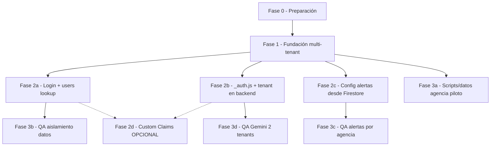

# Guía de workspaces paralelos — Fase 2 y Fase 3

**Versión:** 1.0  
**Fecha:** Junio 2026  
**Referencia:** `docs/PLAN-ESCALABILIDAD-MULTI-AGENCIA.md`

Este documento organiza cómo trabajar en paralelo la **Fase 2** (auth y backend) y la **Fase 3** (agencia piloto y QA) sin pisarse en merge. No modifica código; es guía operativa para el equipo.

---

## 1. Respuesta rápida

| Pregunta | Respuesta |
|----------|-----------|
| ¿Hace falta Fase 2 completa para empezar Fase 3? | **No** para empezar. **Sí** para cerrar/validar Fase 3. |
| ¿Qué prerequisito comparten? | **Fase 1** (fundación multi-tenant). |
| ¿Puede la IA crear workspaces sola? | **No.** Vos abrís ventanas/worktrees; la IA opera en el workspace conectado. |
| ¿Puede la IA delegar en paralelo? | Sí, con subagentes en la misma sesión, pero **no reemplaza** workspaces aislados para evitar conflictos de merge. |

---

## 2. Mapa de dependencias

### 2.1 Entre fases (según el plan)

```
Fase 0 → Fase 1 → Fase 2 → Fase 3 → Fase 4 → Fase 5
```

### 2.2 Desglose fino (qué bloquea qué)



### 2.3 Fase 2: qué bloquea cada ítem de Fase 3

| Ítem Fase 2 | ¿Bloquea Fase 3? | Para qué ítem de Fase 3 |
|-------------|------------------|-------------------------|
| Login con lookup `users/{uid}` | **Sí** | Aislamiento: sin `agencyId` en sesión no hay tenant |
| `_auth.js` + Firestore Admin + tenant | **Sí** | QA Gemini con 2 tenants; seguridad en functions |
| Externalizar alertas (`agencies/{id}.alerts`) | **Sí** (solo ese test) | Alertas y EmailJS independientes por agencia |
| Custom Claims (opcional) | **No** | Optimización; Fase 3 funciona sin esto |

**Mínimo de Fase 2 para cerrar Fase 3:** login + `_auth.js` con tenant + alertas externalizadas.

### 2.4 Fase 3: qué se puede adelantar sin Fase 2

| Ítem Fase 3 | ¿Empezar antes de Fase 2? | Condición |
|-------------|---------------------------|-----------|
| Onboarding agencia piloto (datos) | **Sí** | Fase 1 con esquema y paths listos |
| Verificar aislamiento A vs B | Preparar tests sí; ejecutar no | Login con `agencyId` (Fase 2a) + rules + `db.js` (Fase 1) |
| Verificar alertas/EmailJS | Preparar datos sí; probar no | Externalizar config (Fase 2c) |
| QA Gemini 2 tenants | Preparar escenarios sí; probar no | `_auth.js` con tenant (Fase 2b) |

---

## 3. Estado actual del código (baseline)

Al momento de escribir esta guía, el repo sigue **single-tenant**:

- `js/db.js` usa `/passengers` global (sin `agencyId`)
- `js/login.js` no hace lookup de `users/{uid}`
- `netlify/functions/_auth.js` usa whitelist hardcodeada de 3 emails
- Alertas EmailJS hardcodeadas en `js/app.mjs` / `js/main.js`
- No hay referencias a `agencyId` ni `agencies/` en el código

**Conclusión:** Fase 1 es prerequisito real antes de abrir workspaces de Fase 2 y Fase 3.

---

## 4. Estrategia de workspaces

### 4.1 Cuántos workspaces y en qué orden

| Orden | Workspace | Rama sugerida | Cuándo abrir |
|-------|-----------|---------------|--------------|
| 1º | Fase 0 + Fase 1 | `feat/multi-tenant-foundation` | Ahora (si no empezó) |
| 2º | Fase 2 — Auth y backend | `feat/phase-2-auth-backend` | Después de merge Fase 1 |
| 3º | Fase 3 — Piloto y QA | `feat/phase-3-pilot-agency` | En paralelo con Fase 2 (desde `main` con F1) |

### 4.2 Orden de merge

```
main
 └── feat/multi-tenant-foundation   (F0 + F1)     ← primero
      ├── feat/phase-2-auth-backend               ← segundo
      └── feat/phase-3-pilot-agency               ← puede empezar en paralelo
```

1. Merge **Fase 1** a `main`.
2. Fase 2 y Fase 3 ramifican desde `main` actualizado.
3. Merge **Fase 2** antes de la integración final de Fase 3.
4. Merge **Fase 3** (scripts + docs + tests; QA E2E verificado post-F2).

### 4.3 Ventana de paralelismo real

```
Fase 0 ──► Fase 1 (un solo workspace)
              │
              ├──► Workspace Fase 2: login + _auth + alertas + branding
              │
              └──► Workspace Fase 3: scripts, datos piloto, tests emulator, docs
                        │
                        └──► Integración/QA E2E cuando F2 tenga mínimo (2a+2b+2c)
```

---

## 5. Checklist — Prerequisito (Fase 0 + Fase 1)

**Un solo workspace.** No abrir Fase 2 ni Fase 3 hasta que esto esté estable (o en rama compartida acordada).

| # | Tarea | Entregable | Bloquea |
|---|-------|------------|---------|
| 0.1 | Versionar `firestore.rules` + `firestore.indexes.json` | Archivos en repo | Todo |
| 0.2 | Entorno staging Firebase/Netlify | Site + proyecto staging | Migración segura |
| 0.3 | Backup Firestore producción | Backup documentado | Rollback |
| 1.1 | Colecciones `agencies`, `users`, `members` | Esquema en Firestore staging | F2 y F3 |
| 1.2 | Agencia `trading-travel` con config actual | Doc `agencies/trading-travel` | F2 y F3 |
| 1.3 | Migrar 3 usuarios a `users/{uid}` | 3 docs con `agencyId` | F2 login |
| 1.4 | Refactor `db.js` → rutas scoped | `agencies/{id}/passengers` | F2 y F3 |
| 1.5 | Reglas Firestore con aislamiento | Rules + tests emulator | F3 QA |
| 1.6 | Scripts migración passengers + notifications | Scripts ejecutables | Cutover |
| 1.7 | Validar Trading Travel igual que hoy | Checklist firmado | Abrir F2/F3 |

**Criterio para abrir los otros workspaces:** Fase 1 mergeada o en rama `feat/multi-tenant-foundation` estable.

---

## 6. Checklist — Workspace A (Fase 2)

**Rama:** `feat/phase-2-auth-backend`  
**Objetivo:** Auth y backend multi-tenant. No crear agencia piloto ni scripts de onboarding.

| # | Tarea | Archivos | Depende de | Bloquea F3 |
|---|-------|----------|------------|------------|
| 2.1 | Login: lookup `users/{uid}` post-auth | `js/login.js` | F1.3 | Sí (aislamiento) |
| 2.2 | Guardar `agencyId` en `sessionStorage` | `js/login.js`, bootstrap app | F1.3 | Sí |
| 2.3 | Rechazar usuario sin agencia / `active=false` | `js/login.js` | F1.3 | Sí |
| 2.4 | `setTenantContext(agencyId)` en `db.js` | `js/db.js` | F1.4 | Sí |
| 2.5 | `_auth.js`: Admin SDK + leer `users/{uid}` | `netlify/functions/_auth.js` | F1.3 | Sí (Gemini) |
| 2.6 | Pasar `{uid, agencyId, role, email}` al handler | `_auth.js`, `gemini-*.js` | F2.5 | Sí (Gemini) |
| 2.7 | Externalizar alertas desde `agencies/{id}.alerts` | `js/app.mjs` o `js/main.js` | F1.2 | Sí (alertas) |
| 2.8 | Branding dinámico desde `agencies/{id}.branding` | `index.html`, `login.html`, app | F1.2 | QA branding F3 |
| 2.9 | Custom Claims (opcional) | Cloud Function | F2.5 | No |
| 2.10 | QA: login 3 usuarios Trading Travel | Manual | F2.1–2.4 | — |
| 2.11 | QA: Gemini rechaza sin `agencyId` | Manual | F2.5–2.6 | — |

### Archivos que SÍ modifica este workspace

- `js/login.js`
- `js/db.js` (solo wiring de tenant si falta)
- `js/app.mjs`, `js/main.js`
- `netlify/functions/_auth.js`
- `netlify/functions/gemini-scan.js`
- `netlify/functions/gemini-travel.js`
- `index.html`, `login.html` (branding dinámico)

### Archivos que NO debe tocar

- `scripts/create-pilot-agency.*`
- `docs/QA-MULTI-TENANT.md`, `docs/ONBOARDING-AGENCIA.md`
- `tests/firestore-rules.test.mjs` (salvo coordinación explícita)

### Criterios de éxito Fase 2

- [ ] Usuario Trading Travel loguea y opera solo sus pasajeros
- [ ] Usuario sin `users/{uid}` o `active=false` no entra
- [ ] Functions Gemini rechazan token sin `agencyId` válido
- [ ] Alertas usan `agencies/{id}.alerts`, no constantes
- [ ] Trading Travel sigue funcionando igual que antes

---

## 7. Checklist — Workspace B (Fase 3)

**Rama:** `feat/phase-3-pilot-agency`  
**Objetivo:** Agencia piloto, datos de prueba, tests de reglas, documentación QA. No modificar login ni `_auth.js`.

| # | Tarea | Entregable | Depende de | Necesita F2 para probar |
|---|-------|------------|------------|-------------------------|
| 3.1 | Script `createPilotAgency` | `scripts/create-pilot-agency.mjs` | F1.1 | No |
| 3.2 | Agencia piloto `agencia-piloto` en staging | Doc Firestore | F1.1 | No |
| 3.3 | 2 usuarios piloto (uno por agencia) | `users/{uid}` × 2 | F1.3 | No |
| 3.4 | Pasajeros dummy por agencia (5+5) | Subcolecciones | F1.4 | No |
| 3.5 | Config alertas distinta por agencia | `agencies/*/alerts` | F1.2 | Sí (envío real) |
| 3.6 | Tests reglas Firestore (emulator) | `tests/firestore-rules.test.mjs` | F1.5 | No |
| 3.7 | Checklist aceptación (plan sección 16) | `docs/QA-MULTI-TENANT.md` | F1 | Parcial sin F2 |
| 3.8 | Escenarios QA Gemini 2 tenants | Doc escenarios | F1 | Sí (ejecutar) |
| 3.9 | Procedimiento onboarding operativo | `docs/ONBOARDING-AGENCIA.md` | F1 | No |
| 3.10 | Integración final post-merge F2 | QA E2E pasando | F2 mínimo | Sí |

### Archivos que SÍ crea/modifica este workspace

- `scripts/create-pilot-agency.mjs`
- `scripts/seed-pilot-passengers.mjs`
- `tests/firestore-rules.test.mjs`
- `docs/QA-MULTI-TENANT.md`
- `docs/ONBOARDING-AGENCIA.md`
- `firestore.rules` (solo si tests revelan gaps — coordinar con Fase 1)

### Archivos que NO debe tocar

- `js/login.js`
- `netlify/functions/_auth.js`
- `js/app.mjs`, `js/main.js`
- `js/db.js` (salvo lectura)

### Criterios de éxito Fase 3

- [ ] Agencia piloto existe en staging con config distinta a trading-travel
- [ ] Tests emulator: aislamiento A/B pasa
- [ ] Checklist QA documentado y reproducible
- [ ] Procedimiento onboarding documentado
- [ ] (Post-merge F2) QA E2E: aislamiento, alertas, Gemini 2 tenants

---

## 8. Conflictos de merge por archivo

| Archivo | Workspace Fase 2 | Workspace Fase 3 | Riesgo |
|---------|------------------|------------------|--------|
| `js/db.js` | Wiring tenant | Solo lectura | Bajo |
| `js/login.js` | Alto | No tocar | Solo F2 |
| `netlify/functions/_auth.js` | Alto | No tocar | Solo F2 |
| `js/app.mjs` / `js/main.js` | Alertas + branding | No tocar | Alto si F3 lo toca |
| `firestore.rules` | Fase 1 | Tests emulator | Medio — coordinar |
| `scripts/*` | No tocar | Alto | Bajo conflicto |
| `docs/QA-*`, `docs/ONBOARDING-*` | No tocar | Alto | Bajo conflicto |

**Regla:** Fase 3 trabaja en scripts, datos y docs; Fase 2 en auth, backend y app runtime.

---

## 9. Coordinación día a día

| Momento | Acción |
|---------|--------|
| Día 0 | Un workspace hace F0+F1 hasta merge |
| Día 1+ | Abrís Workspace A (F2) y B (F3) desde `main` actualizado |
| En paralelo | A: auth/backend — B: scripts, datos, tests emulator, docs |
| Antes de merge F3 | Merge F2 a `main`, rebase rama F3 |
| Cierre | Workspace B ejecuta QA E2E con F2 integrada |

---

## 10. Prompts para pegar en cada workspace

Copiá el bloque completo en el chat del workspace correspondiente.

---

### 10.1 Prompt — Fase 0 + Fase 1 (prerequisito)

```markdown
# Contexto — DocTravel Fase 0+1: Fundación Multi-Tenant

Implementar la base multi-tenant antes de abrir workspaces paralelos de Fase 2 y Fase 3.
Referencia: `docs/PLAN-ESCALABILIDAD-MULTI-AGENCIA.md` (Fases 0 y 1, secciones 5–7).
Guía operativa: `docs/GUIA-WORKSPACES-PARALELOS.md`

## Objetivo
- Versionar firestore.rules e indexes
- Crear esquema agencies/users/members
- Refactor db.js a rutas scoped
- Migrar trading-travel sin pérdida de datos
- Reglas con aislamiento + tests básicos

## No implementar aún
- Login con lookup users (Fase 2)
- _auth.js con Admin SDK (Fase 2)
- Agencia piloto segunda (Fase 3)
- Panel super-admin (Fase 4)

Leé el plan y el código actual (db.js, login.js, _auth.js). Proponé plan de migración con rollback antes de tocar código.
```

---

### 10.2 Prompt — Workspace A (Fase 2)

```markdown
# Contexto — DocTravel Fase 2: Auth y Backend Multi-Tenant

Estoy en el workspace dedicado a **Fase 2** del plan de escalabilidad multi-agencia.
Documento de referencia: `docs/PLAN-ESCALABILIDAD-MULTI-AGENCIA.md` (secciones 7, 8, Fase 2).
Guía operativa: `docs/GUIA-WORKSPACES-PARALELOS.md`

## Estado esperado de Fase 1 (prerequisito)
- Colecciones `agencies`, `users`, `members` en Firestore
- Rutas scoped: `/agencies/{agencyId}/passengers` y `/notifications`
- Reglas Firestore con aislamiento por `agencyId`
- Agencia `trading-travel` migrada con datos actuales
- `db.js` refactorizado con `setTenantContext(agencyId)`

Si Fase 1 no está completa, decime qué falta antes de implementar.

## Objetivo de ESTE workspace (solo Fase 2)
Implementar auth y backend multi-tenant. NO tocar scripts de onboarding piloto ni datos de agencia B (eso es otro workspace).

### Tareas en orden
1. `js/login.js`: post-login leer `users/{uid}`, validar `active`, guardar `agencyId` en sessionStorage, redirect o signOut con error
2. Bootstrap app (`js/app.mjs` o `js/main.js`): leer `agencyId` de sessionStorage, llamar `setTenantContext(agencyId)`
3. `netlify/functions/_auth.js`: reemplazar whitelist hardcodeada por Firestore Admin SDK → leer `users/{uid}`, validar `active` + `agencyId`, devolver `{ uid, agencyId, role, email }`
4. `gemini-scan.js` y `gemini-travel.js`: recibir contexto de tenant del auth verificado
5. Externalizar alertas: leer `agencies/{agencyId}.alerts` (EmailJS keys, email destino) en lugar de constantes hardcodeadas
6. Branding dinámico: título/logo/colores desde `agencies/{agencyId}.branding` en index y login
7. (Opcional, al final) Custom Claims vía Cloud Function

### Archivos que SÍ puedo modificar
- `js/login.js`
- `js/db.js` (solo si falta `setTenantContext` o wiring de tenant)
- `js/app.mjs`, `js/main.js`
- `netlify/functions/_auth.js`
- `netlify/functions/gemini-scan.js`
- `netlify/functions/gemini-travel.js`
- `index.html`, `login.html` (solo branding dinámico)

### Archivos que NO debo tocar
- `scripts/create-pilot-agency.*` (workspace Fase 3)
- `docs/QA-MULTI-TENANT.md`, `docs/ONBOARDING-AGENCIA.md` (workspace Fase 3)
- `tests/firestore-rules.test.mjs` (workspace Fase 3, salvo coordinación)

### Criterios de éxito
- [ ] Usuario Trading Travel loguea y opera solo sus pasajeros
- [ ] Usuario sin `users/{uid}` o `active=false` no entra
- [ ] Functions Gemini rechazan token sin `agencyId` válido
- [ ] Alertas usan config de `agencies/{id}.alerts`, no constantes
- [ ] Trading Travel sigue funcionando igual que antes de Fase 2

### Reglas
- Leer archivos antes de modificar
- Cambios mínimos y enfocados
- No implementar panel super-admin (Fase 4)
- No crear segunda agencia piloto (Fase 3)
- Commits pequeños con mensajes claros

Empezá leyendo: `docs/PLAN-ESCALABILIDAD-MULTI-AGENCIA.md`, `docs/GUIA-WORKSPACES-PARALELOS.md`, `js/login.js`, `js/db.js`, `netlify/functions/_auth.js`, `js/app.mjs` (o `js/main.js`). Luego proponé plan de implementación antes de escribir código.
```

---

### 10.3 Prompt — Workspace B (Fase 3)

```markdown
# Contexto — DocTravel Fase 3: Segunda Agencia Piloto y QA

Estoy en el workspace dedicado a **Fase 3** del plan de escalabilidad multi-agencia.
Documento de referencia: `docs/PLAN-ESCALABILIDAD-MULTI-AGENCIA.md` (secciones 6, 10, 16, Fase 3).
Guía operativa: `docs/GUIA-WORKSPACES-PARALELOS.md`

## Estado esperado de Fase 1 (prerequisito)
- Esquema multi-tenant en Firestore (`agencies`, `users`, subcolecciones scoped)
- Reglas Firestore versionadas en repo
- `trading-travel` migrada y operativa

Fase 2 puede NO estar mergeada aún. En ese caso trabajo en scripts, datos de prueba, tests de reglas y documentación. La QA E2E final espera a que Fase 2 entregue login + _auth.js + alertas externalizadas.

## Objetivo de ESTE workspace (solo Fase 3)
Preparar onboarding de agencia piloto, datos de prueba, tests de aislamiento y checklists. NO modificar auth ni login (eso es otro workspace).

### Tareas en orden
1. Script `scripts/create-pilot-agency.mjs`: crear agencia `agencia-piloto` con branding y alerts de prueba
2. Crear usuarios piloto en `users/{uid}` (Firebase Auth + doc Firestore) — uno para trading-travel, uno para agencia-piloto
3. Seed de pasajeros dummy (mínimo 5 por agencia) bajo paths correctos
4. Tests Firestore Rules con emulator: usuario A no lee `/agencies/B/passengers`
5. Documentar `docs/QA-MULTI-TENANT.md` con checklist sección 16 del plan
6. Documentar `docs/ONBOARDING-AGENCIA.md` (pasos operativos sin panel super-admin)
7. Escenarios de prueba para Gemini con 2 tenants (documento, no ejecutar hasta merge Fase 2)
8. **Después de merge Fase 2:** ejecutar QA E2E completo y marcar checklist

### Archivos que SÍ puedo crear/modificar
- `scripts/create-pilot-agency.mjs`
- `scripts/seed-pilot-passengers.mjs`
- `tests/firestore-rules.test.mjs`
- `docs/QA-MULTI-TENANT.md`
- `docs/ONBOARDING-AGENCIA.md`
- `firestore.rules` (solo si tests revelan gaps — coordinar con Fase 1)

### Archivos que NO debo tocar
- `js/login.js`
- `netlify/functions/_auth.js`
- `js/app.mjs`, `js/main.js` (alertas y branding — workspace Fase 2)
- `js/db.js` (salvo lectura para entender paths)

### Criterios de éxito
- [ ] Agencia piloto existe en staging con config distinta a trading-travel
- [ ] Tests emulator: aislamiento A/B pasa
- [ ] Checklist QA documentado y reproducible
- [ ] Procedimiento onboarding documentado (script/manual)
- [ ] (Post-merge F2) QA E2E: aislamiento, alertas independientes, Gemini 2 tenants

### Reglas
- Leer `docs/PLAN-ESCALABILIDAD-MULTI-AGENCIA.md` y `docs/GUIA-WORKSPACES-PARALELOS.md` antes de empezar
- No implementar panel super-admin (Fase 4)
- No modificar flujo de login ni backend auth
- Usar staging, nunca producción para datos piloto
- Commits pequeños

Empezá leyendo el plan, el esquema de datos (sección 6), y el estado actual de `js/db.js` y reglas Firestore si existen. Proponé estructura de scripts y tests antes de escribir código.
```

---

## 11. Sobre delegación con IA

| Capacidad | ¿Posible? | Notas |
|-----------|-----------|-------|
| Crear workspaces Cursor automáticamente | No | El usuario abre ventanas, carpetas o git worktrees |
| Trabajar en 2 repos a la vez sin conflicto | Parcial | Solo con workspaces/worktrees separados |
| Delegar con subagentes en la misma sesión | Sí | Mismo entorno; útil para tareas puntuales, no para evitar merge conflicts |
| Ejecutar F2 y F3 en paralelo sin coordinación | No recomendado | Separar por archivos según sección 8 |

---

## 12. Resumen ejecutivo

1. **Fase 1 es prerequisito** de Fase 2 y Fase 3.
2. **Fase 2 completa no es necesaria** para empezar Fase 3, pero **sí** para validarla end-to-end.
3. **Mínimo Fase 2 para cerrar Fase 3:** login + `_auth.js` con tenant + alertas desde Firestore.
4. **Paralelismo seguro:** Fase 3 adelanta scripts, datos y docs; Fase 2 hace auth/backend; integración cuando F2 alcance el mínimo.
5. **Prompts listos** en sección 10 para copiar en cada workspace.

---

*Documento operativo. Complementa `docs/PLAN-ESCALABILIDAD-MULTI-AGENCIA.md` sin reemplazarlo.*