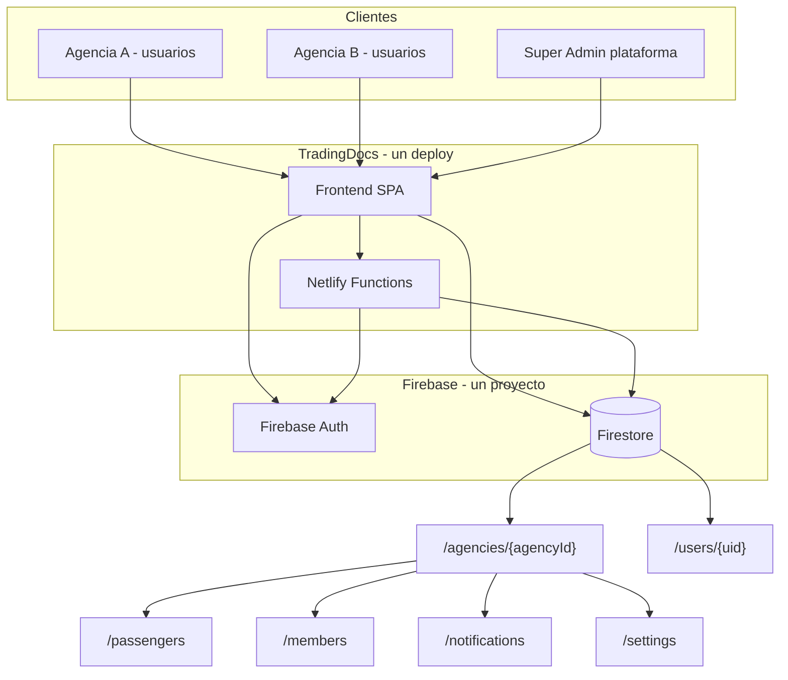
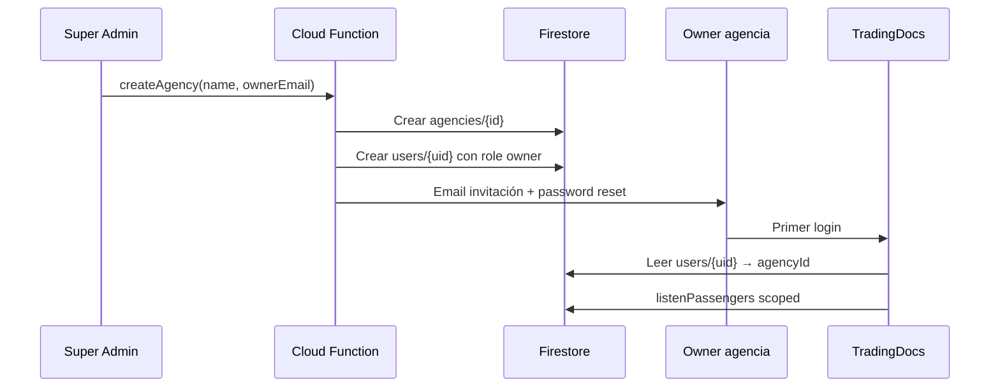

# Plan de escalabilidad multi-agencia — TradingDocs / DocTravel

**Versión:** 1.0  
**Fecha:** Junio 2026  
**Estado:** Propuesta de arquitectura (sin implementar)

---

## 1. Objetivo

Transformar DocTravel (TradingDocs) de una aplicación **single-tenant** — hoy usada por una sola agencia con ~3 usuarios — en una plataforma **multi-tenant** donde:

- Cada agencia tiene **sus propios usuarios**, **sus propios pasajeros** y **su configuración** (marca, alertas, integraciones).
- Los datos de una agencia **no son visibles ni modificables** por otra.
- El mismo deploy de software puede servir a **N agencias** sin fork de código por cliente.
- Existe un camino de migración desde el estado actual **sin pérdida de datos**.

---

## 2. Estado actual (baseline)

### 2.1 Arquitectura

| Componente | Implementación actual |
|------------|----------------------|
| Frontend | HTML/CSS/JS vanilla (`index.html`, `js/app.mjs`) |
| Auth | Firebase Auth (email/password) |
| Base de datos | Firestore — proyecto `doctravel-agencia` |
| Backend IA | Netlify Functions (`gemini-scan`, `gemini-travel`) |
| Hosting | Netlify (un solo site) |
| Alertas email | EmailJS desde el cliente |

### 2.2 Esquema Firestore actual

```
/passengers/{passengerId}       ← todos los pasajeros (sin agencyId)
/notifications/{key}            ← deduplicación global de alertas
/config/allowedEmails           ← preparado pero no usado en auth
```

Comentario explícito en `js/db.js`: *"Todos los pasajeros van en /passengers (una sola agencia, 3 usuarios)"*.

### 2.3 Reglas de seguridad actuales (documentadas)

```javascript
match /passengers/{docId} {
  allow read, write: if request.auth != null;
}
```

**Problema:** cualquier usuario autenticado accede a **todos** los pasajeros. No hay aislamiento.

### 2.4 Valores hardcodeados por agencia (Trading Travel)

| Elemento | Ubicación |
|----------|-----------|
| Marca `TradingDocs` | `index.html`, `login.html` |
| Firebase config | `js/config.js` |
| Whitelist de 3 emails | `netlify/functions/_auth.js` |
| Email alertas `contacto@tradingtravel.com.ar` | `js/app.mjs` |
| Credenciales EmailJS | `js/app.mjs` |
| Mensajes de email con firma TradingDocs | `js/app.mjs` |

### 2.5 Conclusión del diagnóstico

La app es **multi-usuario en tiempo real**, pero **no multi-tenant**. La base técnica (Firebase + Netlify + functions con JWT) es reutilizable; falta el modelo de tenancy, las reglas de aislamiento y la configuración por agencia.

---

## 3. Principios de diseño

1. **Aislamiento fuerte de datos** — reglas Firestore como fuente de verdad, no solo filtros en el cliente.
2. **Un código, muchos tenants** — evitar deploys separados por agencia salvo casos enterprise.
3. **Migración incremental** — Trading Travel sigue operando durante la transición.
4. **Configuración externa** — branding, emails y claves por agencia, no en código.
5. **Roles mínimos viables** — `owner`, `admin`, `agent` (extensible después).
6. **Operación simple** — onboarding de una agencia nueva en minutos, no días.

---

## 4. Enfoques de arquitectura evaluados

### Opción A — Multi-tenant en un solo Firebase (recomendada)

Un proyecto Firebase, un deploy Netlify, datos particionados por `agencyId`.

| Pros | Contras |
|------|---------|
| Un solo costo de infra | Reglas Firestore más complejas |
| Un deploy, un pipeline CI | Índices compuestos por tenant |
| Onboarding rápido | Responsabilidad de aislamiento en rules |
| Escala a cientos de agencias pequeñas | |

### Opción B — Un Firebase por agencia

Cada agencia tiene su propio proyecto Firebase y opcionalmente su site Netlify.

| Pros | Contras |
|------|---------|
| Aislamiento máximo | N proyectos, N configs, N facturas |
| Reglas simples por proyecto | Onboarding lento y manual |
| Ideal para enterprise con compliance estricto | Imposible mantener con el equipo actual |

### Opción C — Híbrido

Multi-tenant por defecto (Opción A) + instancia dedicada para clientes grandes que lo paguen.

**Recomendación:** empezar con **Opción A** y reservar Opción B solo para contratos enterprise futuros.

---

## 5. Arquitectura objetivo



### 5.1 Resolución de tenant

Orden de prioridad al iniciar sesión:

1. Leer `users/{uid}.agencyId` en Firestore (lookup post-login).
2. Alternativa futura: **Custom Claims** en el token (`agencyId`, `role`) vía Cloud Function en login.
3. Opcional: resolver por subdominio (`agencia-x.tradingdocs.com.ar` → `agencyId`).

El `agencyId` queda en memoria de sesión (`sessionStorage`) y **todas** las operaciones de `db.js` lo usan como prefijo de ruta.

---

## 6. Modelo de datos propuesto

### 6.1 Colección `agencies`

```
/agencies/{agencyId}
  name: string              // "Trading Travel"
  slug: string              // "trading-travel" (URL, único)
  status: "active" | "suspended" | "trial"
  plan: "starter" | "pro" | "enterprise"
  branding:
    appName: string         // "TradingDocs"
    logoUrl: string
    primaryColor: string
  alerts:
    email: string           // contacto@agencia.com
    emailjsPublicKey: string
    emailjsServiceId: string
    emailjsTemplateId: string
  createdAt, updatedAt
  trialEndsAt: timestamp | null
```

### 6.2 Colección `users` (índice global usuario → agencia)

```
/users/{uid}               // uid = Firebase Auth UID
  agencyId: string
  email: string
  role: "owner" | "admin" | "agent"
  displayName: string
  active: boolean
  createdAt
```

Permite reglas del tipo: *"solo accedé a datos de tu `agencyId`"*.

### 6.3 Miembros por agencia (auditoría y gestión)

```
/agencies/{agencyId}/members/{uid}
  email, role, active, invitedAt, lastLoginAt
```

### 6.4 Pasajeros (mismo schema actual, scoped)

```
/agencies/{agencyId}/passengers/{passengerId}
  // Schema actual sin cambios:
  lastname, firstname, dob, gender, nationality,
  email, whatsapp, notes,
  dni, parg, pext, visas[], visa1, visa2,
  asistencias[], ffn[],
  birthdayNotifiedYear,
  createdAt, updatedAt
```

### 6.5 Notificaciones de alertas

```
/agencies/{agencyId}/notifications/{key}
  sentAt: timestamp
  // key: tdAlert_{passengerId}_{docType}_{expDate}
```

### 6.6 Invitaciones (onboarding de usuarios)

```
/agencies/{agencyId}/invites/{inviteId}
  email, role, token, expiresAt, acceptedAt
```

### 6.7 Super-admin de plataforma (opcional fase 3)

```
/platform/admins/{uid}
  email, permissions: ["create_agency", "suspend_agency", ...]
```

---

## 7. Seguridad y reglas Firestore

### 7.1 Helper en reglas

```javascript
function userAgency() {
  return get(/databases/$(database)/documents/users/$(request.auth.uid)).data.agencyId;
}

function userRole() {
  return get(/databases/$(database)/documents/users/$(request.auth.uid)).data.role;
}

function isMemberOf(agencyId) {
  return request.auth != null && userAgency() == agencyId && userRole() in ['owner','admin','agent'];
}

function isAdminOf(agencyId) {
  return request.auth != null && userAgency() == agencyId && userRole() in ['owner','admin'];
}
```

### 7.2 Reglas mínimas

```javascript
rules_version = '2';
service cloud.firestore {
  match /databases/{database}/documents {

    match /users/{uid} {
      allow read: if request.auth != null && request.auth.uid == uid;
      allow write: if false; // solo Cloud Functions / super-admin
    }

    match /agencies/{agencyId} {
      allow read: if isMemberOf(agencyId);
      allow update: if isAdminOf(agencyId);

      match /passengers/{passengerId} {
        allow read, write: if isMemberOf(agencyId);
      }

      match /notifications/{key} {
        allow read, write: if isMemberOf(agencyId);
      }

      match /members/{memberId} {
        allow read: if isMemberOf(agencyId);
        allow write: if isAdminOf(agencyId);
      }
    }
  }
}
```

### 7.3 Netlify Functions (`_auth.js`)

Reemplazar whitelist hardcodeada por:

1. Verificar JWT (como hoy).
2. Leer `users/{uid}` en Firestore Admin SDK.
3. Validar `active == true` y `agencyId` presente.
4. Pasar `{ uid, agencyId, role, email }` al handler de la function.
5. Rechazar si el usuario no pertenece a ninguna agencia activa.

### 7.4 Custom Claims (fase 2, recomendado)

Cloud Function `onUserLogin` que setea:

```json
{ "agencyId": "abc123", "role": "agent" }
```

Beneficios: menos lecturas a Firestore en cada request; validación en rules con `request.auth.token.agencyId`.

---

## 8. Cambios por capa del sistema

### 8.1 `js/db.js`

| Hoy | Objetivo |
|-----|----------|
| `collection(db, 'passengers')` | `collection(db, 'agencies', agencyId, 'passengers')` |
| Sin contexto de tenant | `setTenantContext(agencyId)` al login |
| `notifications` global | `agencies/{agencyId}/notifications` |

Todas las funciones (`listenPassengers`, `addPassenger`, `isNotified`, etc.) reciben o leen el `agencyId` activo.

### 8.2 `js/app.mjs`

- Cargar branding y config de alertas desde `agencies/{agencyId}` al iniciar.
- Reemplazar constantes `AGENCY_EMAIL`, `EMAILJS_*` por valores del tenant.
- Mensajes de email usan `branding.appName` de la agencia.
- Dashboard y alertas operan solo sobre datos ya filtrados por tenant (defensa en profundidad).

### 8.3 `js/login.js`

Flujo post-login:

```
signInWithEmailAndPassword()
  → getDoc(users/{uid})
  → si no existe o active=false → signOut + error
  → guardar agencyId en sessionStorage
  → redirect index.html
```

### 8.4 `js/config.js`

- Fase 1: mismo Firebase project para todos.
- Fase futura: config por entorno vía variables de build si se necesitan proyectos separados.

### 8.5 UI (`index.html`, `login.html`)

- Título, logo y colores dinámicos desde `agency.branding`.
- Selector de agencia solo para super-admin o usuarios multi-agencia (caso raro).

### 8.6 Netlify Functions

- `gemini-scan.js` / `gemini-travel.js`: recibir `agencyId` del auth verificado; opcionalmente rate-limit por tenant.
- Mover prompts genéricos; eliminar referencias hardcodeadas a vuelos específicos de Trading Travel.

---

## 9. Roles y permisos

| Rol | Pasajeros | Usuarios | Config agencia | Facturación |
|-----|-----------|----------|----------------|-------------|
| **owner** | CRUD | Invitar/remover admins y agents | Editar todo | Ver plan |
| **admin** | CRUD | Invitar agents | Editar alertas/branding | — |
| **agent** | CRUD | — | Solo lectura | — |

Regla general: los agents no pueden ver datos de otra agencia ni invitar usuarios.

---

## 10. Onboarding de una agencia nueva



Pasos operativos:

1. Super-admin crea agencia (panel o script).
2. Se asigna owner con email.
3. Owner configura branding, email de alertas, invita agents.
4. La agencia opera de forma aislada desde el primer día.

---

## 11. Plan de migración por fases

### Fase 0 — Preparación (1–2 semanas)

- [ ] Versionar `firestore.rules` y `firestore.indexes.json` en el repo.
- [ ] Documentar schema actual y volumen de datos.
- [ ] Crear entorno staging en Firebase/Netlify.
- [ ] Backup completo de Firestore producción.

### Fase 1 — Fundación multi-tenant (2–3 semanas)

- [ ] Implementar colecciones `agencies`, `users`, `members`.
- [ ] Crear agencia `trading-travel` con config actual (emails, EmailJS, branding).
- [ ] Migrar usuarios actuales a `users/{uid}` con `agencyId` de Trading Travel.
- [ ] Refactor `db.js` para rutas bajo `agencies/{agencyId}/`.
- [ ] Actualizar reglas Firestore con aislamiento.
- [ ] Script de migración: `/passengers` → `/agencies/trading-travel/passengers`.
- [ ] Script: `/notifications` → `/agencies/trading-travel/notifications`.

**Criterio de éxito:** Trading Travel opera igual que hoy, con datos bajo el nuevo path.

### Fase 2 — Auth y backend (1–2 semanas)

- [ ] Login con lookup de `users/{uid}`.
- [ ] `_auth.js` con Firestore Admin + validación de tenant.
- [ ] Custom Claims opcionales vía Cloud Function.
- [ ] Externalizar config de alertas (leer de `agencies/{id}.alerts`).

### Fase 3 — Segunda agencia piloto (1 semana)

- [ ] Onboarding de agencia piloto (datos de prueba).
- [ ] Verificar aislamiento: usuario A no ve pasajeros de B.
- [ ] Verificar alertas y EmailJS independientes por agencia.
- [ ] QA de functions Gemini con dos tenants.

### Fase 4 — Panel super-admin y comercial (2–4 semanas)

- [ ] UI para crear/suspender agencias.
- [ ] Gestión de miembros e invitaciones desde la app.
- [ ] Planes `trial` / `starter` / `pro` con límites (usuarios, pasajeros).
- [ ] Métricas por agencia (uso IA, cantidad de pasajeros).

### Fase 5 — Escala y hardening (continuo)

- [ ] Índices compuestos: `agencyId + createdAt`, `agencyId + exp` (alertas).
- [ ] Rate limiting por tenant en functions.
- [ ] Logs estructurados con `agencyId`.
- [ ] Monitoreo de costos Firebase/Gemini por agencia.
- [ ] Política de retención y exportación de datos (GDPR / derecho al olvido).

---

## 12. Estrategia de deploy y dominios

### Modelo recomendado (inicio)

- **Un dominio:** `app.tradingdocs.com.ar` (o similar).
- **Un login** con resolución de tenant post-auth.
- Branding dinámico por agencia en la misma URL.

### Modelo avanzado (opcional)

- Subdominio por agencia: `{slug}.tradingdocs.com.ar`.
- Netlify branch subdomains o wildcard DNS.
- Resolver `slug` → `agencyId` antes del login (pre-fill o validación de membresía).

### Variables de entorno (Netlify)

| Variable | Alcance |
|----------|---------|
| `GEMINI_API_KEY` | Plataforma (facturación centralizada) o por plan |
| `FIREBASE_API_KEY` | Plataforma |
| `FIREBASE_SERVICE_ACCOUNT` | Functions (Admin SDK) |
| `PLATFORM_SUPER_ADMIN_EMAILS` | Solo fase 4 |

La config por agencia (EmailJS, email alertas, branding) vive en **Firestore**, no en env vars.

---

## 13. Facturación y límites (producto SaaS)

Propuesta de límites por plan para controlar costos de Firebase y Gemini:

| Plan | Usuarios | Pasajeros | Escaneos IA/mes |
|------|----------|-----------|-----------------|
| Trial (14 días) | 2 | 50 | 20 |
| Starter | 3 | 500 | 100 |
| Pro | 10 | 5.000 | 500 |
| Enterprise | Ilimitado | Ilimitado | A medida |

Implementación: Cloud Function que incrementa contadores en `agencies/{id}/usage/{month}` y bloquea operaciones al superar límites.

---

## 14. Riesgos y mitigaciones

| Riesgo | Impacto | Mitigación |
|--------|---------|------------|
| Reglas Firestore mal configuradas | Fuga de datos entre agencias | Tests de rules con emulator; auditoría pre-prod |
| Migración con downtime | Agencia sin acceso | Migración por copia + cutover en ventana corta; rollback plan |
| EmailJS en frontend | Credenciales expuestas | Fase futura: enviar alertas vía Cloud Function |
| Costos Gemini descontrolados | Margen negativo | Rate limit y cuotas por plan |
| IDs de pasajero colisionan entre tenants | Alertas incorrectas | Prefijo `agencyId` en keys de notificación (ya resuelto con subcolección) |
| Usuario en dos agencias | Complejidad UX | No soportar en v1; un usuario = una agencia |

---

## 15. Estimación de esfuerzo

| Fase | Duración estimada | Dependencias |
|------|-------------------|--------------|
| Fase 0 — Preparación | 1–2 semanas | — |
| Fase 1 — Fundación | 2–3 semanas | Fase 0 |
| Fase 2 — Auth/backend | 1–2 semanas | Fase 1 |
| Fase 3 — Piloto 2ª agencia | 1 semana | Fase 2 |
| Fase 4 — Super-admin | 2–4 semanas | Fase 3 |
| Fase 5 — Hardening | Continuo | Fase 4 |

**Total hasta segunda agencia en producción:** ~6–8 semanas de desarrollo.

---

## 16. Checklist de aceptación multi-tenant

Antes de dar acceso a una agencia externa, verificar:

- [ ] Usuario de agencia A no puede leer `/agencies/B/passengers` (rules + prueba manual).
- [ ] Alertas email van al destino configurado de **su** agencia.
- [ ] Branding muestra nombre/logo de **su** agencia.
- [ ] Functions Gemini rechazan token de usuario sin `agencyId`.
- [ ] Notificaciones de vencimiento no se mezclan entre agencias.
- [ ] Alta de pasajero crea documento bajo el path correcto.
- [ ] Migración de Trading Travel completa y validada.
- [ ] Backup y procedimiento de restore documentados.

---

## 17. Decisiones abiertas (requieren definición de negocio)

1. **¿Un usuario puede pertenecer a varias agencias?** (recomendación v1: no)
2. **¿Quién paga Firebase/Gemini — plataforma o cada agencia?**
3. **¿Subdominio personalizado por agencia desde el día 1 o más adelante?**
4. **¿Migrar EmailJS a backend en fase 2 o postergar?**
5. **¿Nombre comercial del producto: TradingDocs, DocTravel u otro umbrella?**

---

## 18. Resumen ejecutivo

| Dimensión | Hoy | Objetivo |
|-----------|-----|----------|
| Tenancy | Implícito (1 agencia) | Explícito (`agencyId` en rutas, auth y rules) |
| Usuarios | 3 emails hardcodeados | Miembros por agencia con roles |
| Datos | `/passengers` global | `/agencies/{id}/passengers` |
| Seguridad | `auth != null` | `auth + agencyId + role` |
| Branding | TradingDocs fijo | Config por agencia en Firestore |
| Alertas | Un EmailJS, un email | Config por agencia |
| Deploy | Un site | Un site multi-tenant (escalable a híbrido) |
| Onboarding | Manual en código | Panel / script + invitación |

La inversión principal no es reescribir la app, sino **introducir el concepto de agencia como eje de todo el sistema**: rutas de Firestore, reglas de seguridad, contexto de sesión y configuración externalizada. Con eso, DocTravel pasa de herramienta interna a **producto SaaS vendible a otras agencias de viajes**.

---

*Documento generado como plan de arquitectura. No modifica código existente.*