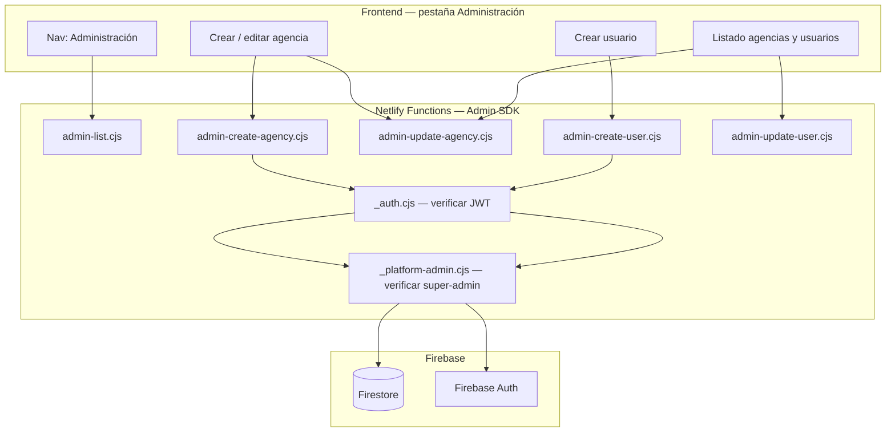

# Plan — Panel de Administración (agencias y usuarios)

**Versión:** 1.1  
**Fecha:** Junio 2026  
**Estado:** Propuesta aprobada — pendiente de implementación (v1.1: correcciones tras revisión de código)  
**Super-admin:** solo `guido@tradingtravel.com.ar`

---

## 1. Objetivo

Agregar una pestaña **Administración** en el sidebar de DocTravel, ubicada **debajo de "Requisitos de Vuelo"**, para que el super-admin de plataforma pueda gestionar agencias y usuarios desde la misma app donde inicia sesión, sin depender de Firebase Console ni scripts CLI.

### Alcance funcional

| Acción | Incluido |
|--------|----------|
| Crear agencias nuevas | Sí |
| Editar agencias existentes (branding, alertas, plan, estado) | Sí |
| Crear usuarios y vincularlos a una agencia | Sí |
| Listar agencias y usuarios | Sí |
| Suspender agencias / desactivar usuarios | Sí |
| Invitar usuarios por email (sin contraseña definida por admin) | No |
| Contraseñas temporales con obligación de cambio | No |

### Decisiones de producto (confirmadas)

| Pregunta | Respuesta |
|----------|-----------|
| ¿Quién es super-admin? | Solo Guido (`guido@tradingtravel.com.ar`) |
| ¿Nombre de la pestaña? | **Administración** |
| ¿Se puede editar agencias existentes? | **Sí** (branding, alertas, plan, estado) |
| ¿Cómo se crean usuarios? | Guido los crea con **contraseña definitiva** (no temporal, sin flujo de invitación por email) |

---

## 2. Contexto actual

DocTravel ya opera en modo **multi-tenant** (Fases 1–3 implementadas):

| Componente | Estado |
|------------|--------|
| Login | `login.html` + `js/login.js` → lee `users/{uid}` → resuelve `agencyId` |
| App principal | `index.html` + `js/app.mjs` |
| Datos | Scoped bajo `agencies/{agencyId}/passengers` y `notifications` |
| Roles por agencia | `owner` · `admin` · `agent` (custom claims en JWT) |
| Alta de agencias hoy | Manual vía scripts (`create-pilot-agency.mjs`, `seed-trading-travel.mjs`) + Firebase Console |
| Panel super-admin | **No existe** — documentado como Fase 4 pendiente en `docs/ONBOARDING-AGENCIA.md` |

### Usuario super-admin

```
guido@tradingtravel.com.ar
  → agencyId: trading-travel
  → role: admin (en su agencia)
  → platformAdmin: true (claim a agregar)
```

El rol `admin` de agencia **no es** lo mismo que super-admin de plataforma. La pestaña Administración depende exclusivamente del claim `platformAdmin`.

### Limitación crítica de Firestore

Las reglas actuales (`firestore.rules`) bloquean operaciones administrativas desde el cliente:

```javascript
match /users/{uid} {
  allow read: if request.auth != null && request.auth.uid == uid;
  allow write: if false;  // solo backend/scripts
}

match /agencies/{agencyId} {
  allow read: if isMemberOf(agencyId);
  allow create, delete: if false;  // solo backend/scripts
  allow update: if isAdminOf(agencyId);  // solo admins de ESA agencia
}
```

**Conclusión:** crear usuarios en Firebase Auth, crear agencias en la raíz y escribir en `users/{uid}` requiere **Netlify Functions con Admin SDK**, reutilizando la lógica de `scripts/lib/seed-helpers.mjs`.

> **Aclaración:** el Admin SDK **bypasea** las `firestore.rules` por diseño (es privilegio de servidor). Por eso editar `agencies/{id}` desde `admin-update-agency` no choca con `allow update: if isAdminOf(agencyId)` — esa regla solo aplica al acceso cliente directo a Firestore, que no se usa en el MVP. Las rules no se modifican y no hay conflicto.

---

## 3. Arquitectura propuesta



### Principio de seguridad

- El frontend **nunca** tiene acceso al Admin SDK.
- Toda operación administrativa valida: JWT válido + `platformAdmin === true` + email coincide con `PLATFORM_SUPER_ADMIN_EMAILS`.
- El listado de agencias y usuarios de **todas** las agencias va exclusivamente por Functions (no se relajan rules de Firestore en el MVP).

### Granularidad de Functions — decisión de implementación

El plan lista 6 endpoints separados por claridad de contratos, pero para un panel de un solo operador **se recomienda consolidar** en 1–2 archivos al implementar:

- **Opción A (recomendada):** un solo `admin-api.cjs` con routing por método + path (`GET /agencies`, `POST /agencies`, `PATCH /agencies/:id`, `POST /users`, `PATCH /users/:id`, `GET /agencies/:id/members`). Menos superficie de deploy, un solo lugar para auth/auditoría.
- **Opción B:** dos archivos — `admin-read.cjs` (listados) + `admin-write.cjs` (crear/editar).
- **Opción C (la del plan literal):** 6 archivos separados. Válido pero más verboso de lo necesario para el MVP.

`_platform-admin.cjs` (verificación de super-admin) se mantiene como helper compartido en cualquier opción. Lo demás es preferencia de implementación; los contratos de API no cambian.

---

## 4. Identificación del super-admin

### Mecanismo (doble verificación)

1. **Variable de entorno Netlify:**
   ```
   PLATFORM_SUPER_ADMIN_EMAILS=guido@tradingtravel.com.ar
   ```

2. **Custom claim en Firebase Auth:**
   ```json
   { "agencyId": "trading-travel", "role": "admin", "platformAdmin": true }
   ```

3. **Script de setup (una vez):**
   ```bash
   GOOGLE_APPLICATION_CREDENTIALS=./keys/tradingdocs-mt.json \
     node scripts/set-platform-admins.mjs
   ```

### Visibilidad de la pestaña en UI

- Tras login, `app.mjs` lee el token con `user.getIdTokenResult()`.
- Si `claims.platformAdmin === true` → mostrar `#nav-admin`.
- Si no → ocultar la pestaña (usuarios de otras agencias no la ven).

---

## 5. Backend — Netlify Functions

### Archivos nuevos

| Archivo | Responsabilidad |
|---------|-----------------|
| `netlify/functions/_platform-admin.cjs` | Verificar JWT + claim `platformAdmin` + email en env |
| `netlify/functions/admin-list.cjs` | GET: listar agencias; GET con `?agencyId=`: listar miembros |
| `netlify/functions/admin-create-agency.cjs` | POST: crear `agencies/{slug}` |
| `netlify/functions/admin-update-agency.cjs` | PATCH: editar agencia (branding, alerts, plan, status) |
| `netlify/functions/admin-create-user.cjs` | POST: `auth.createUser()` + `linkUserToAgency()` |
| `netlify/functions/admin-update-user.cjs` | PATCH: cambiar rol, activar/desactivar, actualizar displayName |

### Módulo compartido

Extraer `linkUserToAgency` y `findUidByEmail` de `scripts/lib/seed-helpers.mjs` a un módulo reutilizable:

```
netlify/functions/lib/tenant-helpers.cjs   ← usado por functions
scripts/lib/seed-helpers.mjs               ← re-exporta o importa el mismo código
```

#### Correcciones obligatorias al extraer el helper

1. **`displayName` falta en `members/{uid}`.** `linkUserToAgency` hoy escribe `displayName` solo en `users/{uid}`, no en `members/{uid}` (ese doc guarda `email, role, active, invitedAt, lastLoginAt`). La tabla de Usuarios del panel planea leer `members.displayName`, que quedaría vacío. Al extraer el helper, agregar `displayName` al doc `members` y **migrar los miembros existentes** (backfill desde `users/{uid}`) en un script único.
2. **`setCustomUserClaims` es sobrescritura total, no merge.** El helper hace `setCustomUserClaims(uid, { agencyId, role })` — si un usuario tiene `platformAdmin: true` y se lo edita reusando ese patrón, **se borra el claim**. La función `admin-update-user` debe leer los claims actuales con `auth.getUser(uid).customClaims` y mergear antes de volver a escribir, preservando `platformAdmin` si existía. El helper expuesto debe aceptar claims extra opcionales: `linkUserToAgency({ ..., extraClaims })`.

> Para el MVP Guido es el único super-admin y no se edita a sí mismo desde el panel, así que esto no rompe hoy — pero la función `admin-update-user` debe implementar el merge desde el día 1 para no dejar la trampa instalada.

### Contratos de API (resumen)

#### `POST /admin-create-agency`

```json
{
  "slug": "viajes-del-sur",
  "name": "Viajes del Sur",
  "plan": "trial",
  "status": "active",
  "branding": {
    "appName": "SurDocs",
    "logoUrl": "assets/logo.jpeg",
    "primaryColor": "#1a4fd6"
  },
  "alerts": {
    "email": "alertas@viajesdelsur.com",
    "emailjsPublicKey": "...",
    "emailjsServiceId": "...",
    "emailjsTemplateId": "..."
  }
}
```

**Respuesta:** `{ ok: true, agencyId: "viajes-del-sur" }`

#### `PATCH /admin-update-agency`

Mismos campos, parcial. Permite cambiar `status` a `suspended` / `active`.

#### `POST /admin-create-user`

```json
{
  "email": "owner@viajesdelsur.com",
  "password": "ContraseñaDefinitiva123",
  "agencyId": "viajes-del-sur",
  "role": "owner",
  "displayName": "Juan Pérez"
}
```

**Flujo backend:**
1. `auth.createUser({ email, password })` — contraseña definitiva, sin flag de cambio obligatorio
2. `linkUserToAgency({ uid, agencyId, member })` — escribe `users/{uid}`, `members/{uid}`, setea claims
3. Devuelve `{ ok: true, uid, email }` (sin devolver la contraseña en la respuesta)

> **Branch "usuario ya existe en Auth":** si `createUser` falla con `auth/email-already-exists`, no abortar. Hoy `create-pilot-agency.mjs` asume que el usuario ya existe y solo lo vincula. El backend debe reusar ese flujo:
> 1. `findUidByEmail(auth, email)` → si devuelve un UID, llamar `linkUserToAgency({ uid, agencyId, member })` sin `createUser`.
> 2. Si el usuario ya está vinculado a **otra agencia**, rechazar con 409 y mensaje claro (el MVP no soporta multi-agencia por usuario).
> 3. Si el email existía y el body trae `password`, resetearla con `auth.updateUser(uid, { password })` antes de vincular. Si no trae `password`, dejar la contraseña intacta.
> 4. Si no existe en Auth ni se pudo crear, devolver el error original.
>
> Esto cubre el caso real de alguien que ya tenía cuenta y que hoy resolvés a mano en Console. El formulario de "Crear usuario" pasa a ser "Crear o vincular usuario".

#### `PATCH /admin-update-user`

```json
{
  "uid": "abc123",
  "role": "agent",
  "active": false,
  "displayName": "Nuevo nombre"
}
```

Actualiza Firestore + `setCustomUserClaims`. Si `active: false`, el login existente ya rechaza la cuenta.

#### `GET /admin-list`

- Sin params → lista todas las agencias (`id`, `name`, `plan`, `status`, `memberCount`)
- `?agencyId=viajes-del-sur` → lista miembros de esa agencia

**`memberCount` — mecanismo:** con 2–3 agencias alcanza un `getDocumentsInCollection('members')` por agencia (N lecturas, trivial). Si la plataforma pasa de ~10 agencias, migrar a un campo denormalizado `memberCount` en `agencies/{id}` actualizado al crear/desactivar usuario (evita el N+1). Dejar el campo preparado en el doc de agencia desde el MVP aunque el listado inicial lo calcule on the fly.

### Seguridad adicional en Functions

- **Logs estructurados + auditoría (MVP):** `{ action, performedBy, agencyId, targetUid, timestamp }`. Persistir un doc de auditoría en `auditLogs/{id}` para historial duradero. Con un solo super-admin, esto alcanza.
  - **Rules de `auditLogs/`:** en el MVP no se agregan reglas de lectura cliente — la colección se escribe vía Admin SDK (bypass de rules) y se consulta desde Firestore Console. Si en el futuro se quiere ver el historial desde la UI, agregar un endpoint `GET /audit` validado por `_platform-admin.cjs` o una regla `allow read: if isPlatformAdmin()`. Dejar `auditLogs/` fuera del match de `firestore.rules` (denegado por defecto para cliente) hasta entonces.
- **Rate limiting → post-MVP.** Las Netlify Functions son stateless; un límite real por UID requiere contadores en Firestore o un store externo. Queda fuera del MVP. Si se implementa después, especificar el mecanismo (contador con TTL en Firestore).
- **No loguear el body de creación/edición de usuario.** Los logs de `admin-create-user` y `admin-update-user` deben excluir `password` — registrar solo `{ action, performedBy, targetUid, email, agencyId }`.
- Validación de slug: `^[a-z0-9-]{3,40}$`, único antes de crear
- Validación de contraseña: mínimo 8 caracteres (política Firebase Auth)

---

## 6. Frontend — Pestaña Administración

### Cambios en `index.html`

**Sidebar** — nuevo botón debajo de "Requisitos de Vuelo":

```html
<button class="nav-item" data-view="admin" id="nav-admin" style="display:none;">
  <svg>...</svg>
  <span>Administración</span>
</button>
```

**Vista principal** — `#view-admin` con dos sub-pestañas internas:

```
[ Agencias ]  [ Usuarios ]
```

### Sub-sección: Agencias

**Formulario crear / editar agencia**

| Campo | Tipo | Validación |
|-------|------|------------|
| Nombre comercial | text | Obligatorio |
| Slug / ID | text | Auto desde nombre, editable, `^[a-z0-9-]+$`, único |
| Plan | select | trial / starter / pro |
| Estado | select | active / suspended |

> **`status` vs `plan` — desambiguación:** `plan` es el plan comercial (`trial`/`starter`/`pro`); `status` es el estado operativo de la agencia, **solo `active` o `suspended`** (quitado el valor `trial` para evitar la confusión "plan pro con status trial"). El login rechaza cualquier `status !== 'active'`. El período de trial se controla por `plan` y fechas, no por `status`.
| Email alertas | email | Obligatorio |
| EmailJS Public Key | text | Opcional (heredar defaults de plataforma si vacío) |
| EmailJS Service ID | text | Opcional |
| EmailJS Template ID | text | Opcional |
| Nombre de la app | text | branding.appName |
| Color primario | color | branding.primaryColor |
| URL del logo | text | branding.logoUrl |

**Tabla de agencias**

| Columna | Contenido |
|---------|-----------|
| Nombre | `agencies.name` |
| Slug | `agencies.slug` |
| Plan | badge |
| Estado | badge (active / suspended) |
| Usuarios | conteo de members |
| Acciones | Editar · Suspender/Reactivar |

Al hacer clic en **Editar**, el formulario se pre-carga con los datos de la agencia seleccionada (modo edición, slug no editable).

### Sub-sección: Usuarios

**Formulario crear usuario**

| Campo | Tipo | Notas |
|-------|------|-------|
| Email | email | Obligatorio, único en Auth |
| Contraseña | password | **Definitiva.** Obligatoria si el usuario no existe en Auth; opcional si ya existe (solo para resetear). Ver §7.3 |
| Agencia | select | Lista de agencias activas |
| Rol | select | owner / admin / agent |
| Nombre | text | displayName |

> **Hint en UI bajo el campo contraseña:** "Solo requerida si el usuario no existe en Auth, o para resetear la existente." La contraseña no se almacena ni se muestra después. Guido la comunica al usuario por WhatsApp, teléfono u otro canal fuera de la app.

**Tabla de usuarios** (filtrada por agencia seleccionada)

| Columna | Contenido |
|---------|-----------|
| Email | `members.email` |
| Nombre | `members.displayName` |
| Rol | badge |
| Estado | activo / inactivo |
| Acciones | Cambiar rol · Desactivar/Reactivar |

### Cambios en `js/app.mjs`

```javascript
const viewTitles = {
  // ...existentes...
  admin: 'Administración'
};

// Tras login exitoso:
const tokenResult = await user.getIdTokenResult();
if (tokenResult.claims.platformAdmin) {
  document.getElementById('nav-admin').style.display = '';
}

// En showView():
if (v === 'admin') renderAdmin();
```

**Funciones nuevas:**

- `renderAdmin()` — carga listas vía `admin-list`
- `submitCreateAgency()` / `submitUpdateAgency()`
- `submitCreateUser()` / `submitUpdateUser()`
- `openEditAgency(agencyId)` — pre-carga formulario
- Helper `adminFetch(path, options)` — adjunta `Authorization: Bearer <idToken>`

### Cambios en `css/main.css`

- Estilos para sub-tabs internas (`.admin-tabs`, `.admin-tab-btn`)
- Tablas de administración (reutilizar patrón de Pasajeros)
- Badges de plan y estado
- Formulario en card (mismo lenguaje visual que Requisitos de Vuelo)

---

## 7. Flujos operativos

### 7.1 Crear agencia nueva

```
1. Guido abre Administración → pestaña Agencias
2. Completa formulario (nombre, slug, plan, alertas, branding)
3. Clic "Crear agencia"
4. POST admin-create-agency
5. Backend crea agencies/{slug}
6. Toast: "Agencia {nombre} creada correctamente"
7. Tabla se actualiza
```

### 7.2 Editar agencia existente

```
1. Clic "Editar" en fila de la tabla
2. Formulario se pre-carga (slug bloqueado)
3. Guido modifica campos (alertas, branding, plan, estado)
4. PATCH admin-update-agency
5. Toast: "Cambios guardados"
```

### 7.3 Crear o vincular usuario

```
1. Guido abre Administración → pestaña Usuarios
2. Selecciona agencia destino
3. Completa email, rol, nombre; contraseña si es usuario nuevo (ver nota)
4. POST admin-create-user
5. Backend:
   - Si el email NO existe en Auth → auth.createUser + linkUserToAgency + claims
   - Si existe y no tiene agencia → solo linkUserToAgency + claims (sin createUser)
   - Si existe y ya pertenece a otra agencia → 409
   - Si el email existe y vino contraseña → auth.updateUser(uid, { password }) para resetearla
6. Toast: "Usuario {email} creado/vinculado en {agencia}"
7. Guido comunica credenciales al usuario por canal externo (solo si creó o reseteó)
8. El usuario inicia sesión — sin obligación de cambio
```

> **Contraseña según escenario:**
> - Usuario **nuevo** → password obligatorio (mín. 8).
> - Usuario **existente** → password **opcional**: si viene, se resetea con `auth.updateUser(uid, { password })`; si no viene, solo se vincula y la contraseña queda intacta.
> - El hint del formulario aclara: "Solo requerida si el usuario no existe en Auth, o para resetear la existente".

### 7.4 Suspender agencia

```
1. Editar agencia → estado = suspended → Guardar
2. PATCH admin-update-agency { status: "suspended" }
3. Usuarios de esa agencia reciben error en próximo login
   (ya implementado en login.js y app.mjs)
```

### 7.5 Desactivar usuario

```
1. Clic "Desactivar" en fila de usuario
2. PATCH admin-update-user { active: false }
3. Usuario no puede volver a entrar
```

---

## 8. Fases de implementación

### Fase 0 — Backend y permisos (1–2 días)

- [ ] Crear `_platform-admin.cjs`
- [ ] Crear `admin-api.cjs` (endpoint único, opción A) — o los 6 archivos separados si se elige opción C
- [ ] Extraer `tenant-helpers.cjs` compartido con scripts (con correcciones `displayName` + merge de claims)
- [ ] Crear `scripts/set-platform-admins.mjs`
- [ ] Configurar `PLATFORM_SUPER_ADMIN_EMAILS=guido@tradingtravel.com.ar` en Netlify staging
- [ ] Ejecutar script para setear claim `platformAdmin: true` en Guido
- [ ] Guido cierra sesión y vuelve a entrar para refrescar claims

### Fase 1 — UI pestaña Administración (1–2 días)

- [ ] Agregar botón nav `#nav-admin` en `index.html` (oculto por defecto)
- [ ] Agregar vista `#view-admin` con sub-tabs Agencias / Usuarios
- [ ] Formulario crear/editar agencia
- [ ] Formulario crear usuario (con campo contraseña definitiva)
- [ ] Tablas de listado
- [ ] Lógica en `app.mjs`: visibilidad, `renderAdmin()`, llamadas a Functions
- [ ] Estilos en `main.css`

### Fase 2 — Pulido, validaciones y tests (1 día)

- [x] Validaciones de formulario en cliente (slug `^[a-z0-9-]{3,40}$`, email regex, contraseña mín. 8 chars)
- [x] Toasts de éxito/error
- [x] Confirmación antes de suspender agencia o desactivar usuario
- [x] Manejo de errores de API (slug duplicado → 409, email ya existe → branch vinculación, email en otra agencia → 409; mensajes del backend surfacen en toasts)
- [x] Estado de carga en botones (`.btn-spinner` en guardar agencia / crear usuario)
- [x] Test de lógica de autorización: `tests/admin-auth.test.mjs` — `checkPlatformAdmin` cubre sin-claim → 403, email-mismatch → 403, happy path (7 tests, `node --test`)
- [x] Ocultar topbar (buscador + Nuevo pasajero) en vista Administración

### Fase 2A — Compresión de imágenes pre-upload en scanner (0.5–1 día)

**Objetivo:** bajar latencia, evitar timeouts de 30 s en Netlify Functions y reducir 503 transitorios de Gemini, **sin degradar la extracción de datos**. Es el fix más barato del pipeline OCR; debe implementarse **antes** de Fase 2B (Document AI).

**Contexto actual:** `js/scanner.js` envía la imagen original en base64 a `gemini-scan` (hasta 20 MB). Fotos de celular (3–8 MB, 3000–4000 px) multiplican tokens, tiempo de request y probabilidad de timeout. Los rate limits de Gemini **no** son el cuello de botella (uso actual ≪ cuota en Tier 1); el problema es payload + latencia + 503 de capacidad.

**Principio de calidad:** el OCR de pasaportes, visas, DNI y MRZ no mejora por encima de ~1500–2000 px de lado largo. Comprimir a **1600 px / JPEG 80%** preserva texto legible y zonas críticas (MRZ, números, fechas) en documentos de viaje típicos. **No se activa compresión agresiva** si compromete la extracción: hay QA de regresión obligatorio antes de deploy.

#### Parámetros acordados (conservadores)

| Parámetro | Valor | Notas |
|-----------|-------|-------|
| Lado largo máximo | **1600 px** | Mantiene aspect ratio; no upscale |
| Formato salida | **JPEG** | `image/jpeg` |
| Calidad JPEG | **0.80** | Bajar a 0.65 solo en 2ª pasada si peso > 2 MB |
| Rotación EXIF | **Sí** | Fotos de celular suelen venir rotadas |
| Skip inteligente | **Sí** | No recomprimir si ya es JPEG, lado largo ≤ 1600 px y peso < 400 KB |
| PDF | **Sin cambios** | No redimensionar; flujo actual |
| GIF animado | **Sin cambios** o convertir solo el primer frame (evaluar en QA) |

#### Checklist — Implementación (cliente, `js/scanner.js` + `js/app.mjs`)

- [x] Nueva función `prepareImageForScan(file)` → devuelve `File` optimizado (Canvas nativo: `createImageBitmap` + `canvas.toBlob`, sin dependencias CDN)
- [x] Invocar en `scanWithGemini()` cuando `file.type.startsWith('image/')` (PDF pasa intacto)
- [x] Log en consola (dev): `scan: {originalKB}KB → {compressedKB}KB ({width}x{height})`
- [x] Preview en modal (`#scan-preview`): muestra la versión comprimida (se comprime en `processScannedFile` y se pasa al scan)
- [x] Import masivo: reutiliza la misma función vía `scanWithGemini` (cada archivo se comprime al escanear)
- [x] Contrato con backend **sin cambios**: `{ mimeType: 'image/jpeg', data: base64 }` hacia `gemini-scan`
- [x] `gemini-scan.cjs`: sin cambios en esta fase
- [x] Smart skip (JPEG <400 KB no se recomprime), GIF intacto, fallback a original si falla el decode
- [x] Simplificación vs plan: **sin 2ª pasada a 0.65** (una sola pasada a 0.80; si un doc falla QA se trata como excepción)

#### Checklist — QA de calidad OCR (obligatorio, bloquea deploy)

Comparar extracción **antes vs después** de compresión con los mismos archivos reales. Criterio: mismos campos críticos rellenados (o equivalentes válidos).

| Documento de prueba | Campos críticos a validar |
|---------------------|---------------------------|
| Pasaporte ARG (foto celular 4+ MB) | apellido, nombre, nº pasaporte, DNI, fechas, MRZ |
| Visa USA | nº visa/folio, fechas, país, pasaporte vinculado |
| DNI ARG | nº, fechas |
| ESTA (si hay muestra) | application number, fechas |
| PDF pasaporte | Sin regresión (no pasa por compresión) |

- [ ] ≥ 5 documentos reales: extracción equivalente o mejor que sin compresión
- [ ] Tiempo de respuesta mediblemente menor (objetivo: 3–5× en fotos > 3 MB)
- [ ] Sin aumento de errores 502/timeout en Netlify en esas pruebas
- [ ] Si algún doc pierde campos → subir calidad a 0.85 o lado largo a 2000 px **solo para ese umbral**, documentar excepción

**Criterio de éxito:** compresión activa en ≥ 90% de fotos de celular; **0 regresiones** en campos críticos del checklist; latencia media del escaneo baja de forma visible en logs.

**Si la calidad no alcanza:** no deployar; ajustar parámetros (1600→2000 px o calidad 0.85) y repetir QA. La compresión es opcional por archivo si falla el decode (fallback al original con warning en consola).

**Orden sugerido:** **primero 2A, después 2B**. 2A sola puede hacer que los 503 pasen a ser raros sin tocar Document AI.

### Fase 2B — Fallback de escaneo OCR ante 503 de Gemini

**Objetivo:** reducir fallos visibles del scanner cuando Gemini responde 503 / alta demanda o la Netlify Function expira a los 30 s. Complementa el panel de administración: sin escaneo confiable, onboarding de agencias nuevas (Fase 3+) queda débil.

**Estado (2026-06):** fallback a **Claude (Anthropic)** implementado en `gemini-scan.cjs`. Document AI queda **postergado y opcional** — si Claude estabiliza el 503 (lo esperado por independencia de pool), puede no ser necesario.

**Documentación detallada (Document AI, postergado):** `docs/doc-travel-document-ai-fallback-setup.md`

**Cadena de fallback acordada** (respetar lo ya implementado en `gemini-scan.cjs`):

```
gemini-3.5-flash (principal — 2 intentos + backoff)
   ↓
gemini-3.1-flash-lite (fallback Gemini — 1 intento)   ← ya en código
   ↓
Claude (Anthropic) — fallback final IMPLEMENTADO      ← pool independiente, mismo schema JSON, cero mapeo
   ↓ (futuro, opcional)
Google Document AI — Form Parser  /  Mistral OCR
   ↓
Error amigable al usuario (sin “pendiente” en MVP)
```

**Infraestructura GCP** (proyecto `doctravel-agencia`, processor `6ccef284ca71a0ce`, location `us`) — ver setup doc.

#### ✅ Implementado — Claude fallback (2026-06)

- [x] `ANTHROPIC_API_KEY` y `ANTHROPIC_MODEL` en Netlify (env vars, no en código)
- [x] Dependencia `@anthropic-ai/sdk` agregada al root `package.json` (mismo patrón que `@google/genai`)
- [x] `processWithClaude(mimeType, data)` en `gemini-scan.cjs`: mismo `SYSTEM_INSTRUCTION` + `PROMPT`, mismo JSON schema → contrato `{ text }` sin cambios para el frontend
- [x] Cadena Gemini (principal + flash-lite) → Claude. Claude se invoca solo si toda la cadena Gemini falla
- [x] Reintentos sobre 529/429/500 de Anthropic con backoff corto
- [x] `timeout: 25000` en el client de Claude para no colgar el budget de la Function
- [x] Soporta imágenes (JPEG/PNG/WebP/GIF) y PDF (document block)
- [x] Logging de `source: 'gemini' | 'claude'` con `agencyId`/`uid` para monitoreo
- [ ] **Pendiente (operativo):** redeploy de Functions en staging + prod para que tome las env vars y la nueva dependencia
- [ ] **Pendiente (QA):** forzar 503 de Gemini y verificar que Claude responde + el form se rellena correctamente

#### Checklist — Document AI (postergado, solo si Claude no alcanza)

#### Checklist — Infra y env (Document AI)

- [x] `GOOGLE_CREDENTIALS` en Netlify (JSON inline de `doc-travel-processor@doctravel-agencia.iam.gserviceaccount.com`)
- [ ] Redeploy de Functions tras agregar la variable (staging y, cuando corresponda, prod)
- [ ] (Opcional) Env vars para no hardcodear: `DOCUMENT_AI_PROCESSOR_ID`, `DOCUMENT_AI_LOCATION`, `DOCUMENT_AI_PROJECT_NUMBER`

#### Checklist — Implementación (`netlify/functions/gemini-scan.cjs`)

- [ ] Agregar dependencia `@google-cloud/documentai` en `netlify/functions/package.json`
- [ ] Implementar `processWithDocumentAI(mimeType, data)` leyendo `GOOGLE_CREDENTIALS`
- [ ] Invocar Document AI solo si fallan **todos** los intentos Gemini (principal + `gemini-3.1-flash-lite`)
- [ ] Mantener `verifyAuth(event)` y logging con `agencyId` / `uid` en cada intento
- [ ] Loguear `source: 'gemini' | 'gemini-lite' | 'document-ai'` para monitoreo de costos
- [ ] Respetar el contrato actual del frontend: respuesta `{ text: "<json string>" }` (mismo que `scanner.js` / `mapScanToForm`)
- [ ] Mapear salida de Document AI al esquema de `prompts/scan-prompt.cjs` (texto OCR + entidades → JSON de pasaporte/visa/DNI/ESTA/asistencia)
- [ ] Reutilizar o portar lógica de parsing existente (`js/scanner.js` / MRZ) donde el Form Parser no devuelva campos estructurados
- [ ] Mensaje de error amigable si Document AI también falla (sin exponer detalles internos)

#### Checklist — QA

- [ ] Escanear JPG de pasaporte con Gemini simulado caído (o en pico real) → respuesta OK vía Document AI
- [ ] Escanear PDF → mismo flujo
- [ ] Verificar que el formulario de pasajero se rellena con datos razonables
- [ ] Confirmar en logs Netlify qué `source` se usó y que no hay timeout a 30 s en el happy path de fallback
- [ ] Probar con usuario de agencia distinta (`almundo` vs `trading-travel`) — auth multi-tenant intacto

#### Fuera de alcance de 2B (postergar)

- Fallback intermedio Claude Sonnet / Mistral OCR (segunda API, más complejidad)
- Cola “guardar como pendiente” si todo falla
- Custom Extractor entrenado en Document AI

**Criterio de éxito:** ante 503 repetido de Gemini, el usuario completa el escaneo sin error visible en ≥ 90% de los casos de prueba con documentos reales (pasaporte + visa).

**Orden sugerido:** ejecutar **después de Fase 2A** (compresión). Puede correr en paralelo con Fase 3 (QA del panel) o inmediatamente antes de Fase 4 (deploy prod).

### Fase 3 — QA en staging (0.5 día)

- [x] Guido ve la pestaña Administración
- [x] Usuario de `agencia-piloto` **no** ve la pestaña
- [x] Crear agencia de prueba desde UI
- [x] Crear usuario con contraseña definitiva → login exitoso
- [] Editar branding/alertas de agencia existente
- [x] Suspender agencia → login rechazado para sus usuarios
- [x] Aislamiento: usuario nuevo solo ve datos de su agencia (`docs/QA-MULTI-TENANT.md`)
- [x] Sin `permission-denied` en consola

### Fase 4 — Deploy y documentación (0.5 día)

- [ ] Deploy a staging → validar → deploy a producción
- [ ] Actualizar `docs/ONBOARDING-AGENCIA.md`: marcar panel como implementado
- [ ] Agregar sección en `docs/instructivo.md` sobre uso del panel

**Total estimado:** 3–4 días consolidando Functions en 1–2 archivos (opción A/B de §3); 4–5 días con 6 archivos separados (opción C). **+0.5–1 día** Fase 2A (compresión imágenes). **+1–2 días** Fase 2B (Document AI). Optimista si staging (`tradingdocs-mt`) ya está configurado; pesimista si hay regresiones OCR en 2A, edge cases EmailJS/branding o mapeo Document AI en 2B.

---

## 9. Wireframe de referencia

```
┌──────────────────────────────────────────────────────────────┐
│  Administración                                              │
│  Gestioná agencias y usuarios de la plataforma               │
├──────────────────────────────────────────────────────────────┤
│  [ Agencias ]  [ Usuarios ]                                  │
├──────────────────────────────────────────────────────────────┤
│                                                              │
│  ── Agencias ──────────────────────────────────────────────  │
│                                                              │
│  ┌─ Nueva agencia / Editar ─────────────────────────────┐   │
│  │ Nombre:     [Viajes del Sur        ]                  │   │
│  │ Slug:       [viajes-del-sur        ] (no editable)    │   │
│  │ Plan:       [trial ▼]   Estado: [active ▼]           │   │
│  │ Alertas:    [alertas@viajesdelsur.com]               │   │
│  │ App:        [SurDocs]   Color: [■ #1a4fd6]          │   │
│  │ EmailJS:    [publicKey] [serviceId] [templateId]     │   │
│  │                          [ Crear agencia ] [ Guardar ]│   │
│  └──────────────────────────────────────────────────────┘   │
│                                                              │
│  Agencias registradas                                        │
│  ┌──────────────┬────────────┬───────┬────────┬──────────┐ │
│  │ Nombre       │ Slug       │ Plan  │ Estado │ Acciones │ │
│  ├──────────────┼────────────┼───────┼────────┼──────────┤ │
│  │ Trading Travel│trading-travel│ pro  │ active │ Editar   │ │
│  │ Agencia Piloto│agencia-piloto│trial │ active │ Editar   │ │
│  └──────────────┴────────────┴───────┴────────┴──────────┘ │
│                                                              │
│  ── Usuarios ──────────────────────────────────────────────  │
│                                                              │
│  Agencia: [viajes-del-sur ▼]                                 │
│                                                              │
│  ┌─ Nuevo usuario ──────────────────────────────────────┐   │
│  │ Email:       [owner@viajesdelsur.com]                 │   │
│  │ Contraseña:  [••••••••••••]  (definitiva)            │   │
│  │ Rol:         [owner ▼]   Nombre: [Juan Pérez]        │   │
│  │                              [ Crear usuario ]        │   │
│  └──────────────────────────────────────────────────────┘   │
│                                                              │
│  Usuarios de viajes-del-sur                                  │
│  ┌────────────────────┬────────┬───────┬────────┬─────────┐ │
│  │ Email              │ Nombre │ Rol   │ Estado │ Acciones│ │
│  ├────────────────────┼────────┼───────┼────────┼─────────┤ │
│  │ owner@viajes...    │ Juan   │ owner │ activo │ Editar  │ │
│  └────────────────────┴────────┴───────┴────────┴─────────┘ │
└──────────────────────────────────────────────────────────────┘
```

---

## 10. Riesgos y mitigaciones

| Riesgo | Impacto | Mitigación |
|--------|---------|------------|
| Admin SDK expuesto en cliente | Crítico | Solo en Netlify Functions |
| Otro usuario accede al panel | Alto | Claim `platformAdmin` + env var con un solo email |
| Slug duplicado al crear agencia | Medio | Validar unicidad en backend antes de escribir |
| Email ya existe en Auth | Medio | Capturar `auth/email-already-exists` → branch de vinculación (ver §5). Mostrar error claro si ya pertenece a otra agencia |
| Contraseña débil | Medio | Validar mín. 8 chars; Guido define contraseñas seguras |
| Suspender/desactivar no cierra sesión activa | Medio | Las `firestore.rules` validan claims, no `agency.status`; `onSnapshot` no re-chequea por query. Una sesión abierta sigue ~1 h hasta refrescar token. Lockout inmediato de usuario: `auth.revokeRefreshTokens(uid)` en `admin-update-user` si `active:false`. Suspender agencia: aceptar ventana ~1 h en el MVP (lockout real post-MVP) |
| Contraseña definitiva tipeada mal | Medio | No hay recovery desde el panel (post-MVP). Criterio: reset manual vía Firebase Console documentado en `instructivo.md` |
| Usuario no refresca claims tras cambio de rol | Bajo | Aviso en UI: "El usuario debe cerrar sesión y volver a entrar" |
| Edición de EmailJS incorrecta | Medio | Validar formato; probar con botón "Enviar email de prueba" (post-MVP) |

---

## 11. Alcance MVP vs. post-MVP

### MVP (esta implementación)

- Pestaña Administración visible solo para Guido
- Crear y editar agencias (branding, alertas, plan, estado)
- Crear usuarios con contraseña definitiva
- Listar agencias y usuarios
- Suspender agencias / desactivar usuarios / cambiar rol

### Post-MVP (no incluido ahora)

- Admin de agencia invita agents desde su propia agencia (sin ser super-admin)
- Botón "Enviar email de prueba" para validar config EmailJS
- Reset de contraseña por email (`sendPasswordResetEmail`) y desde el panel
- Rate limiting real por UID (contadores en Firestore)
- Lockout inmediato al suspender agencia (no solo al refrescar token)
- Límites por plan (usuarios, pasajeros, escaneos IA/mes)
- Métricas de uso por agencia
- Relajar Firestore rules con `isPlatformAdmin()` para lectura directa
- Segundo super-admin (requeriría actualizar env var y script)

---

## 12. Orden de implementación recomendado

```
1. scripts/set-platform-admins.mjs + ejecutar en staging
2. netlify/functions/_platform-admin.cjs (helper verificación super-admin)
3. netlify/functions/lib/tenant-helpers.cjs (extraer de seed-helpers + correcciones displayName/claims)
4. netlify/functions/admin-api.cjs (endpoint único, opción A — routing por método+path:
     GET  /agencies, POST /agencies, PATCH /agencies/:id,
     GET  /agencies/:id/members, POST /users, PATCH /users/:id)
   ─ alternativa: 6 archivos separados (opción C) si se prefiere el plan literal
5. index.html — nav + vista #view-admin
6. app.mjs — visibilidad, renderAdmin(), llamadas API
7. main.css — estilos
8. Tests: 403 sin platformAdmin (node --test)
9. QA en staging (tradingdocs-mt)
10. Deploy producción + actualizar docs
```

> Si elegís la opción C (6 archivos), el paso 4 se desglosa en `admin-list`, `admin-create-agency`, `admin-update-agency`, `admin-create-user`, `admin-update-user` como en la v1.0. Los contratos son los mismos.

---

## 13. Criterios de aceptación

Antes de dar por terminado:

- [ ] Solo `guido@tradingtravel.com.ar` ve la pestaña Administración
- [ ] Usuario de `agencia-piloto` no ve la pestaña ni puede llamar a las Functions admin (403)
- [ ] Se puede crear una agencia nueva completa desde la UI
- [ ] Se puede editar branding y alertas de una agencia existente
- [ ] Se puede crear un usuario con contraseña definitiva y loguearse con él
- [ ] Un email ya existente en Auth se **vincula** a la agencia (no falla); si ya pertenece a otra agencia, se rechaza con 409 claro
- [ ] Editar un usuario con `platformAdmin` no le borra el claim (merge de claims verificado)
- [ ] El usuario nuevo solo ve pasajeros de su agencia (aislamiento OK)
- [ ] Suspender agencia bloquea login de sus usuarios
- [ ] Desactivar usuario bloquea su login
- [ ] Desactivar usuario revoca su sesión activa (`revokeRefreshTokens`) o se documenta la ventana de ~1 h
- [ ] Los logs de Functions no contienen `password` en ningún campo
- [ ] Test automatizado: request sin `platformAdmin` → 403
- [ ] Sin errores `permission-denied` en consola para Guido
- [ ] `docs/ONBOARDING-AGENCIA.md` actualizado: panel disponible, scripts CLI como alternativa

---

## 14. Referencias

| Documento | Relación |
|-----------|----------|
| `docs/PLAN-ESCALABILIDAD-MULTI-AGENCIA.md` | Arquitectura multi-tenant (Fase 4 = este panel) |
| `docs/ONBOARDING-AGENCIA.md` | Procedimiento manual que este panel reemplaza |
| `docs/instructivo.md` | Guía operativa de usuarios y agencias |
| `docs/QA-MULTI-TENANT.md` | Checklist de aislamiento post-implementación |
| `docs/doc-travel-document-ai-fallback-setup.md` | Infra GCP, processor Document AI y código base (Fase 2B) |
| `scripts/lib/seed-helpers.mjs` | Lógica base a reutilizar en Functions |
| `firestore.rules` | Reglas actuales (no se modifican en MVP) |

---

*Documento generado a partir del plan de arquitectura y las decisiones de producto confirmadas. No modifica código existente.*